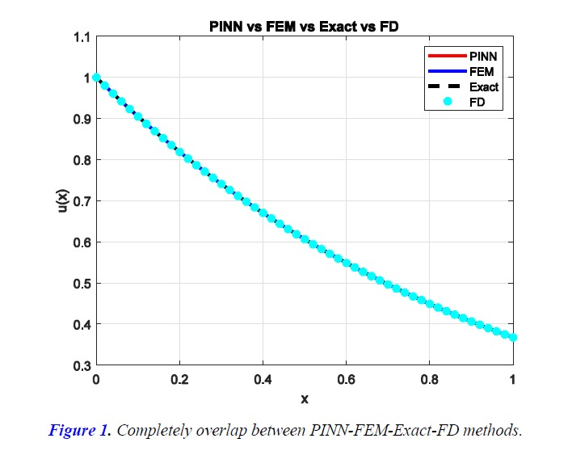
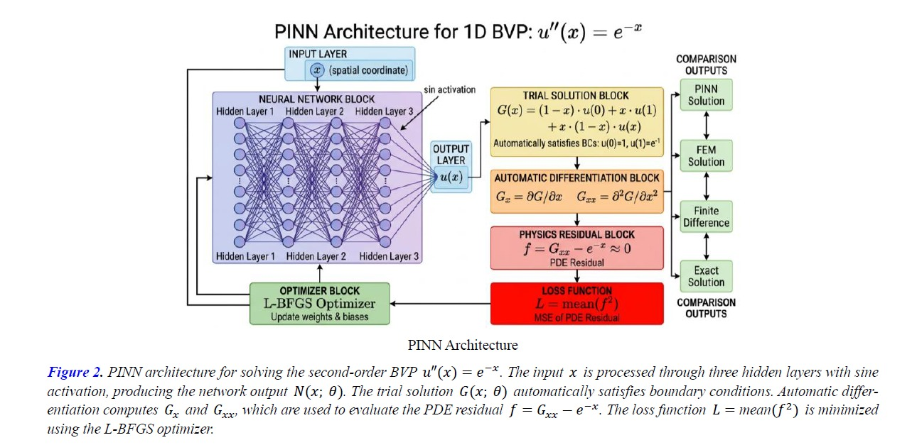

Physics-informed neural networks (PINNs) have emerged as a promising computational approach for solving differential equations by incorporating physical laws into neural network training. This study compares PINNs with the Finite Element Method (FEM) and Finite Difference (FD) methods for solving second-order boundary value problems. The proposed PINN framework employs a feedforward neural network, automatic differentiation, L-BFGS optimization, and Sobol quasi-random collocation points. Numerical experiments evaluate accuracy, convergence properties, and computational efficiency. The results demonstrate that PINNs can achieve accuracy comparable to classical numerical methods while offering advantages such as mesh-free computation, flexibility for complex domains, and straightforward incorporation of physical constraints. Although FEM and FD methods can be more efficient for low-dimensional problems, PINNs provide a versatile alternative for more complex geometries and higher-dimensional problems.

## 1. Introduction

The numerical solution of partial differential equations (PDEs) has been a cornerstone of computational science and engineering for decades. Traditional methods, such as the Finite Element Method (FEM) and Finite Difference (FD) schemes, are effective but often require significant domain expertise, mesh generation, and computational resources.

Recent advances in deep learning have introduced **Physics-Informed Neural Networks (PINNs)**, which incorporate governing physical laws directly into neural network loss functions. PINNs provide mesh-free solutions by minimizing violations of governing equations, boundary conditions, and initial conditions.

Despite their potential, PINNs face challenges related to hyperparameter sensitivity, collocation point distribution, network architecture, and optimization. This study presents a comparative investigation of PINNs, FEM, and FD methods for a second-order boundary value problem.

The benchmark problem is defined as:

$$
u''(x)=e^{-x}, \qquad x\in[0,1]
$$

subject to the Dirichlet boundary conditions:

$$
u(0)=1,\qquad u(1)=e^{-1}
$$

The study focuses on three main contributions:

1. **Mathematical derivations:** Detailed derivations of the PINN trial solution, automatic differentiation, loss function, FEM weak formulation, and FD schemes.
2. **Implementation details:** A three-layer feedforward neural network with 10 neurons per layer, sine activation functions, He initialization, Sobol quasi-random collocation points, and L-BFGS optimization.
3. **Quantitative comparison:** Evaluation of accuracy, convergence, and computational characteristics using PINNs, FEM (50 elements), and FD (50 intervals).

The paper is organized into seven sections covering the mathematical formulation, numerical methods, neural network architecture, training procedure, numerical results, comparative analysis, and conclusions.

## 2. Mathematical Formulation

### 2.1. Problem Statement

The study considers the second-order linear ordinary differential equation:

$$
\frac{d^2u}{dx^2}=e^{-x},\qquad x\in\Omega=[0,1]
$$

with Dirichlet boundary conditions:

$$
u(0)=u_0=1,\qquad u(1)=u_1=e^{-1}
$$

This two-point boundary value problem represents physical systems such as steady-state heat conduction with exponentially decaying source terms, beam deflection under distributed loads, and electrostatic potential distributions.

### 2.2. Exact Solution

The general solution of the homogeneous equation \(u''(x)=0\) is:

$$
u_h(x)=C_1+C_2x
$$

For the particular solution, we seek \(u_p(x)\) such that:

$$
u_p''(x)=e^{-x}
$$

The exact analytical solution is used as a benchmark for evaluating the accuracy of the numerical methods.

### Exact Solution (Continued)

The particular solution is:

$$
u_p(x)=e^{-x}
$$

Since

$$
\frac{d}{dx}e^{-x}=-e^{-x},
\qquad
\frac{d^2}{dx^2}e^{-x}=e^{-x}
$$

the general solution is:

$$
u(x)=C_1+C_2x+e^{-x}
$$

Applying the boundary conditions:

$$
u(0)=C_1+1=1\implies C_1=0
$$

$$
u(1)=C_2+e^{-1}=e^{-1}\implies C_2=0
$$

Therefore, the exact solution is:

$$
\boxed{u(x)=e^{-x}}
$$

This closed-form solution serves as the ground truth for evaluating numerical methods.

### 2.3. Weak Formulation

For the Finite Element Method (FEM), the weak (variational) formulation is obtained by multiplying the PDE by a test function \(v\in H_0^1(\Omega)\) and integrating over the domain:

$$
\int_0^1 u''(x)v(x)\,dx
=
\int_0^1 e^{-x}v(x)\,dx
$$

Integrating by parts:

$$
\int_0^1 u''(x)v(x)\,dx
=
[u'(x)v(x)]_0^1
-
\int_0^1 u'(x)v'(x)\,dx
$$

Since \(v\in H_0^1(\Omega)\), we have \(v(0)=v(1)=0\). Therefore, the boundary term vanishes:

$$
-\int_0^1 u'(x)v'(x)\,dx
=
\int_0^1 e^{-x}v(x)\,dx
$$

Rearranging gives the weak formulation:

$$
\int_0^1 u'(x)v'(x)\,dx
=
-\int_0^1 e^{-x}v(x)\,dx
$$

Find \(u\in H^1(\Omega)\), satisfying \(u(0)=1\) and \(u(1)=e^{-1}\), such that

$$
\int_0^1 u'(x)v'(x)\,dx
=
-\int_0^1 e^{-x}v(x)\,dx,
\qquad
\forall v\in H_0^1(\Omega)
$$

This formulation provides the foundation for the Finite Element Method.

## 3. Methodology

### 3.1. Physics-Informed Neural Networks (PINNs)

#### 3.1.1. Neural Network Approximation

PINNs approximate the solution \(u(x)\) using a feedforward neural network \(N(x;\theta)\), where \(\theta\) represents the trainable parameters (weights and biases).

For a network with \(L\) layers, the forward pass is defined recursively:

$$
z^{(1)}=W^{(1)}x+b^{(1)}
$$

$$
a^{(1)}=\sigma(z^{(1)})
$$

$$
z^{(\ell)}=W^{(\ell)}a^{(\ell-1)}+b^{(\ell)},
\qquad \ell=2,\ldots,L-1
$$

$$
a^{(\ell)}=\sigma(z^{(\ell)})
$$

$$
N(x;\theta)=W^{(L)}a^{(L-1)}+b^{(L)}
$$

where \(W^{(\ell)}\) and \(b^{(\ell)}\) denote the weight matrix and bias vector of layer \(\ell\), and \(\sigma(\cdot)\) is the activation function.

The implementation uses the sine activation function:

$$
\sigma(z)=\sin(z)
$$

The sine function is suitable for learning smooth solutions to differential equations because its derivatives are bounded and periodic.

#### 3.1.2. Trial Solution Formulation

The PINN implementation constructs a trial solution that automatically satisfies the Dirichlet boundary conditions, eliminating the need for hard constraints or penalty terms in the loss function.

The trial solution is defined as:

$$
G(x;\theta)
=
(1-x)u_0+xu_1+x(1-x)N(x;\theta)
$$

where \(u_0=u(0)=1\) and \(u_1=u(1)=e^{-1}\) are the prescribed boundary values.

**At \(x=0\):**

$$
G(0;\theta)=1=u_0
$$

**At \(x=1\):**

$$
G(1;\theta)=e^{-1}=u_1
$$

Thus, \(G(x;\theta)\) satisfies both boundary conditions exactly for any choice of network parameters \(\theta\). The term \(x(1-x)\) acts as a window function that vanishes at both boundaries.

The trial solution can be decomposed as:

$$
G(x;\theta)=(1-x)u_0+xu_1+x(1-x)N(x;\theta)
$$

The first term provides a linear interpolation between boundary values, while the second term allows the network to learn the deviation from linearity required to satisfy the PDE.

### 3.1.3. Automatic Differentiation

To evaluate the PDE residual, we need to compute the second derivative of \(G(x;\theta)\) with respect to \(x\). Automatic differentiation (AD) enables exact computation of derivatives through the chain rule, avoiding numerical approximation errors inherent in finite difference schemes.

**First Derivative**

Differentiating \(G(x;\theta)\) with respect to \(x\):

$$
\frac{\partial G}{\partial x}
=
\frac{\partial}{\partial x}
\left[(1-x)u_0+xu_1+x(1-x)N(x;\theta)\right]
$$

Applying the product rule and chain rule:

$$
\frac{\partial G}{\partial x}
=
-u_0+u_1+
\frac{\partial}{\partial x}
\left[x(1-x)N(x;\theta)\right]
$$

For the last term:

$$
\begin{aligned}
\frac{\partial}{\partial x}
[x(1-x)N(x;\theta)]
&=(1-x)N(x;\theta)\\
&\quad-xN(x;\theta)
+x(1-x)\frac{\partial N}{\partial x}
\end{aligned}
$$

Simplifying:

$$
\frac{\partial}{\partial x}
[x(1-x)N(x;\theta)]
=
(1-2x)N(x;\theta)
+x(1-x)\frac{\partial N}{\partial x}
$$

Therefore,

$$
\boxed{
\frac{\partial G}{\partial x}
=
-u_0+u_1+(1-2x)N(x;\theta)
+x(1-x)\frac{\partial N}{\partial x}
}
$$

**Second Derivative**

Differentiating again with respect to \(x\):

$$
\begin{aligned}
\frac{\partial^2G}{\partial x^2}
&=
\frac{\partial}{\partial x}
\left[
-u_0+u_1+(1-2x)N(x;\theta)
+x(1-x)\frac{\partial N}{\partial x}
\right]
\end{aligned}
$$

The first two terms vanish. For the third term:

$$
\frac{\partial}{\partial x}
[(1-2x)N(x;\theta)]
=
-2N(x;\theta)
+(1-2x)\frac{\partial N}{\partial x}
$$

For the fourth term, using the product rule:

$$
\begin{aligned}
\frac{\partial}{\partial x}
\left[x(1-x)\frac{\partial N}{\partial x}\right]
&=(1-2x)\frac{\partial N}{\partial x}\\
&\quad+x(1-x)\frac{\partial^2N}{\partial x^2}
\end{aligned}
$$

Combining:

$$
\boxed{
\begin{aligned}
\frac{\partial^2G}{\partial x^2}
&=-2N(x;\theta)
+2(1-2x)\frac{\partial N}{\partial x}\\
&\quad+x(1-x)\frac{\partial^2N}{\partial x^2}
\end{aligned}
}
$$

This expression is computed using automatic differentiation. Modern deep learning frameworks, such as TensorFlow, PyTorch, and MATLAB Deep Learning Toolbox, provide built-in AD capabilities that compute derivatives by applying the chain rule to the computational graph.

**Computational Graph for Automatic Differentiation**

The neural network \(N(x;\theta)\) is a composition of functions:

$$
N(x;\theta)=f_L\circ f_{L-1}\circ\cdots\circ f_1(x)
$$

where each \(f_\ell\) represents a layer operation. The chain rule gives:

$$
\frac{\partial N}{\partial x}
=
\frac{\partial f_L}{\partial a^{(L-1)}}
\cdot
\frac{\partial a^{(L-1)}}{\partial a^{(L-2)}}
\cdots
\frac{\partial a^{(1)}}{\partial z^{(1)}}
\cdot
\frac{\partial z^{(1)}}{\partial x}
$$

For the sine activation function, \(\sigma(z)=\sin(z)\):

$$
\frac{\partial \sigma}{\partial z}=\cos(z)
$$

The second derivative is computed by differentiating the computational graph of \(\partial N/\partial x\) with respect to \(x\), requiring higher-order derivative support in the AD framework.

### 3.1.4. Loss Function Derivation

The PINN loss function enforces the PDE at a set of collocation points \(\{x_i\}_{i=1}^{N_c}\) in the interior of the domain. The PDE residual at point \(x_i\) is:

$$
r(x_i;\theta)
=
\frac{\partial^2G(x_i;\theta)}{\partial x^2}
-e^{-x_i}
$$

The loss function is the mean squared residual:

$$
\mathcal{L}(\theta)
=
\frac{1}{N_c}
\sum_{i=1}^{N_c}
[r(x_i;\theta)]^2
$$

Expanding:

$$
\boxed{
\mathcal{L}(\theta)
=
\frac{1}{N_c}
\sum_{i=1}^{N_c}
\left[
\frac{\partial^2G(x_i;\theta)}{\partial x^2}
-e^{-x_i}
\right]^2
}
$$

**Interpretation**

1. **PDE residual term:** The quantity

   $$
   \frac{\partial^2G(x_i;\theta)}{\partial x^2}-e^{-x_i}
   $$

   measures how well the trial solution satisfies the governing differential equation at each collocation point.

   Minimizing the loss function encourages the neural network to approximate a solution that satisfies the PDE throughout the computational domain.

   ### PINN Loss Function (Continued)

2. **Mean Squared Error:** Squaring the residual penalizes large deviations, and averaging over all collocation points provides a global measure of PDE satisfaction.

3. **No Boundary Terms:** Since \(G(x;\theta)\) satisfies the boundary conditions by construction, no additional penalty terms are needed.

**Gradient Computation**

Training the network requires computing the gradient of the loss with respect to the parameters:

$$
\nabla_\theta\mathcal{L}(\theta)
=
\frac{1}{N_c}\sum_{i=1}^{N_c}
2\left[
\frac{\partial^2G(x_i;\theta)}{\partial x^2}-e^{-x_i}
\right]
\frac{\partial}{\partial\theta}
\left[
\frac{\partial^2G(x_i;\theta)}{\partial x^2}
\right]
$$

This involves computing third-order mixed derivatives, which are handled automatically by the automatic differentiation framework through backpropagation.

### 3.1.5. Collocation Point Selection

The choice of collocation points significantly impacts PINN performance. This study employs **Sobol sequences**, a type of quasi-random low-discrepancy sequence that provides more uniform domain coverage than pseudo-random sampling.

**Sobol Sequence Properties**

1. **Low Discrepancy:** Sobol points minimize the maximum distance between any point in the domain and the nearest collocation point.
2. **Deterministic:** Unlike random sampling, Sobol sequences are deterministic and reproducible.
3. **Uniform Coverage:** For \(N_c=10\) points in \([0,1]\), Sobol sequences ensure better spatial distribution than uniform or random grids.

The Sobol sequence \(\{x_i\}_{i=1}^{10}\) is generated using the `sobolset` function in MATLAB, which implements the algorithm of Bratley and Fox.

## 3.2. Finite Element Method (FEM)

### 3.2.1. Domain Discretization

The domain \(\Omega=[0,1]\) is discretized into \(N=50\) elements of equal length:

$$
h=\frac{L}{N}=\frac{1}{50}=0.02
$$

The nodes are:

$$
x_i=ih,\qquad i=0,1,\ldots,N
$$

Each element \(\Omega_e=[x_{e-1},x_e]\) has length \(h\).

### 3.2.2. Finite Element Approximation

The solution is approximated using piecewise linear basis functions (hat functions). The global approximation is:

$$
u_h(x)=\sum_{j=0}^{N}U_j\phi_j(x)
$$

where \(U_j\) are the nodal values and \(\phi_j(x)\) are the global basis functions satisfying:

$$
\phi_j(x_i)=\delta_{ij}
=
\begin{cases}
1, & i=j,\\
0, & i\ne j.
\end{cases}
$$

For linear elements, the basis functions are:

$$
\phi_j(x)=
\begin{cases}
\dfrac{x-x_{j-1}}{h}, & x\in[x_{j-1},x_j],\\[6pt]
\dfrac{x_{j+1}-x}{h}, & x\in[x_j,x_{j+1}],\\[6pt]
0, & \text{otherwise}.
\end{cases}
$$

### 3.2.3. Weak Formulation and Galerkin Method

Substituting \(u_h(x)\) into the weak formulation and choosing test functions \(v=\phi_i\), for \(i=1,\ldots,N-1\) (interior nodes), gives:

$$
\sum_{j=0}^{N}U_j
\int_0^1\phi_j'(x)\phi_i'(x)\,dx
=
-\int_0^1e^{-x}\phi_i(x)\,dx
$$

This leads to the linear system:

$$
\mathbf{K}\mathbf{U}=\mathbf{F}
$$

where:

1. \(\mathbf{K}\) is the global stiffness matrix with entries

   $$
   K_{ij}=\int_0^1\phi_j'(x)\phi_i'(x)\,dx.
   $$

2. \(\mathbf{U}=[U_0,U_1,\ldots,U_N]^T\) is the vector of nodal values.

3. \(\mathbf{F}\) is the global load vector with entries

   $$
   F_i=-\int_0^1e^{-x}\phi_i(x)\,dx.
   $$

### 3.2.4. Element Stiffness Matrix Derivation

For an element \(e\) spanning \([x_{e-1},x_e]\), the local basis functions are defined as:

$$
\psi_1^e(\xi)=1-\xi,\qquad
\psi_2^e(\xi)=\xi,\qquad
\xi\in[0,1]
$$

where \(\xi=(x-x_{e-1})/h\) is the local coordinate. The derivatives with respect to \(x\) are:

$$
\frac{d\psi_1^e}{dx}
=
\frac{d\psi_1^e}{d\xi}\frac{d\xi}{dx}
=
(-1)\frac{1}{h}
=
-\frac{1}{h}
$$

$$
\frac{d\psi_2^e}{dx}
=
\frac{d\psi_2^e}{d\xi}\frac{d\xi}{dx}
=
(1)\frac{1}{h}
=
\frac{1}{h}
$$

The element stiffness matrix is:

$$
K_{ij}^{e}
=
\int_{x_{e-1}}^{x_e}
\frac{d\psi_i^e}{dx}
\frac{d\psi_j^e}{dx}\,dx
$$

### 3.2.4. Element Stiffness Matrix Derivation (Continued)

Computing each entry:

$$
K_{11}^{e}
=
\int_{x_{e-1}}^{x_e}
\left(-\frac{1}{h}\right)
\left(-\frac{1}{h}\right)\,dx
=
\frac{1}{h}
$$

$$
K_{12}^{e}
=
\int_{x_{e-1}}^{x_e}
\left(-\frac{1}{h}\right)
\left(\frac{1}{h}\right)\,dx
=
-\frac{1}{h}
$$

$$
K_{21}^{e}=K_{12}^{e}=-\frac{1}{h}
$$

$$
K_{22}^{e}
=
\int_{x_{e-1}}^{x_e}
\left(\frac{1}{h}\right)
\left(\frac{1}{h}\right)\,dx
=
\frac{1}{h}
$$

Thus, the element stiffness matrix is:

$$
\boxed{
K^e=\frac{1}{h}
\begin{bmatrix}
1 & -1\\
-1 & 1
\end{bmatrix}
}
$$

This \(2\times2\) matrix is assembled into the global stiffness matrix by adding contributions from each element to the appropriate global indices.

### 3.2.5. Element Load Vector Derivation

The element load vector is:

$$
F_i^e=-\int_{x_{e-1}}^{x_e}e^{-x}\psi_i^e(x)\,dx
$$

We approximate the integral using the midpoint rule:

$$
\int_{x_{e-1}}^{x_e}e^{-x}\psi_i^e(x)\,dx
\approx
e^{-x_m}\int_{x_{e-1}}^{x_e}\psi_i^e(x)\,dx
$$

where

$$
x_m=\frac{x_{e-1}+x_e}{2}
$$

is the element midpoint. Since

$$
\int_{x_{e-1}}^{x_e}\psi_1^e(x)\,dx
=
\int_{x_{e-1}}^{x_e}\psi_2^e(x)\,dx
=
\frac{h}{2}
$$

we have:

$$
F_1^e=-e^{-x_m}\frac{h}{2},
\qquad
F_2^e=-e^{-x_m}\frac{h}{2}
$$

Thus:

$$
\boxed{
F^e=-e^{-x_m}\frac{h}{2}
\begin{bmatrix}
1\\
1
\end{bmatrix}
}
$$

### 3.2.6. Assembly and Boundary Conditions

The global stiffness matrix \(K\) and load vector \(F\) are assembled by summing element contributions:

$$
K_{ij}=\sum_{e:\,i,j\in\Omega_e}K_{ij}^e,
\qquad
F_i=\sum_{e:\,i\in\Omega_e}F_i^e
$$

To enforce Dirichlet boundary conditions \(U_0=1\) and \(U_N=e^{-1}\), the system is modified:

$$
K_{0,j}=0\quad\text{for all }j,
\qquad K_{0,0}=1,\qquad F_0=1
$$

$$
K_{N,j}=0\quad\text{for all }j,
\qquad K_{N,N}=1,\qquad F_N=e^{-1}
$$

The resulting system \(KU=F\) is solved using Gaussian elimination or other direct solvers.

## 3.3. Finite Difference Method (FD)

### 3.3.1. Grid Discretization

The domain \([0,1]\) is discretized into \(N=50\) intervals with grid spacing:

$$
h=\frac{1}{N}=0.02
$$

The grid points are:

$$
x_i=ih,\qquad i=0,1,\ldots,N
$$

### 3.3.2. Central Difference Approximation

The second derivative is approximated using the central difference formula. Starting from Taylor expansions:

$$
u(x_{i+1})
=
u(x_i)+hu'(x_i)+\frac{h^2}{2}u''(x_i)
+\frac{h^3}{6}u'''(x_i)+O(h^4)
$$

$$
u(x_{i-1})
=
u(x_i)-hu'(x_i)+\frac{h^2}{2}u''(x_i)
-\frac{h^3}{6}u'''(x_i)+O(h^4)
$$

Adding these equations:

$$
u(x_{i+1})+u(x_{i-1})
=
2u(x_i)+h^2u''(x_i)+O(h^4)
$$

Solving for \(u''(x_i)\):

$$
u''(x_i)
=
\frac{u(x_{i+1})-2u(x_i)+u(x_{i-1})}{h^2}
+O(h^2)
$$

This is a second-order accurate approximation. Substituting into the PDE \(u''(x_i)=e^{-x_i}\):

$$
\frac{u_{i+1}-2u_i+u_{i-1}}{h^2}=e^{-x_i}
$$

Rearranging:

$$
u_{i-1}-2u_i+u_{i+1}=h^2e^{-x_i}
$$

### 3.3.3. Linear System Formulation

For interior points \(i=1,2,\ldots,N-1\), we have:

$$
u_{i-1}-2u_i+u_{i+1}=h^2e^{-x_i}
$$

For boundary points:

$$
u_0=1,\qquad u_N=e^{-1}
$$

This leads to the linear system:

$$
Au=b
$$

The coefficient matrix \(A\) is:

$$
A=
\begin{bmatrix}
1 & 0 & 0 & \cdots & 0\\
1 & -2 & 1 & \cdots & 0\\
0 & 1 & -2 & \ddots & \vdots\\
\vdots & \ddots & \ddots & \ddots & 1\\
0 & \cdots & 0 & 1 & -2 & 1\\
0 & \cdots & 0 & 0 & 0 & 1
\end{bmatrix}
$$

The right-hand-side vector is:

$$
b=
\begin{bmatrix}
1\\
h^2e^{-x_1}\\
h^2e^{-x_2}\\
\vdots\\
h^2e^{-x_{N-1}}\\
e^{-1}
\end{bmatrix}
$$

The matrix \(A\) is tridiagonal, symmetric, and diagonally dominant, ensuring stability and efficient solution via Thomas algorithm or direct solvers.

### 3.3.4. Truncation Error Analysis

The local truncation error of the central difference scheme is \(O(h^2)\). By the Lax Equivalence Theorem, for a consistent and stable scheme, the global error also converges as \(O(h^2)\). For \(h=0.02\), we expect errors on the order of \(10^{-4}\) to \(10^{-3}\), depending on the smoothness of the solution.

# 4. Neural Network Architecture

## 4.1. Network Topology

The PINN architecture consists of a fully connected feedforward neural network with the following specifications:

1. **Input Layer:** 1 neuron (spatial coordinate \(x\)).
2. **Hidden Layers:** 3 layers, each with 10 neurons.
3. **Output Layer:** 1 neuron (network output \(N(x;\theta)\)).
4. **Activation Function:** \(\sigma(z)=\sin(z)\) for all hidden layers.
5. **Total Parameters:**

   $$
   (1\times10+10)+(10\times10+10)\times2
   +(10\times1+1)
   $$

   $$
   =10+10+110+110+11=251
   $$

   Therefore, the network has 251 parameters.

## 4.2. Weight Initialization

Proper initialization is critical for training deep networks. We employ He initialization, which is designed for networks with ReLU-like activations but also works well for sine activations. For a layer with \(n_{\mathrm{in}}\) input neurons, weights are initialized as:

$$
W_{ij}\sim\mathcal{N}\left(0,\frac{2}{n_{\mathrm{in}}}\right)
$$

where \(\mathcal{N}(\mu,\sigma^2)\) denotes a Gaussian distribution with mean \(\mu\) and variance \(\sigma^2\). The factor \(2/n_{\mathrm{in}}\) ensures that the variance of activations remains approximately constant across layers, preventing vanishing or exploding gradients.

**Derivation of He Initialization**

Consider a layer with input \(\mathbf{x}\in\mathbb{R}^{n_{\mathrm{in}}}\) and output \(\mathbf{z}=W\mathbf{x}+\mathbf{b}\). Assume \(\mathbf{x}\) has zero mean and unit variance, and \(W_{ij}\) are independently and identically distributed (i.i.d.) with zero mean and variance \(\sigma_W^2\). The variance of \(z_i\) is:

$$
\operatorname{Var}(z_i)
=
\operatorname{Var}\left(\sum_{j=1}^{n_{\mathrm{in}}}W_{ij}x_j\right)
=
\sum_{j=1}^{n_{\mathrm{in}}}
\operatorname{Var}(W_{ij})\operatorname{Var}(x_j)
$$

$$
=n_{\mathrm{in}}\sigma_W^2
$$

To maintain \(\operatorname{Var}(z_i)=1\), we set:

$$
\sigma_W^2=\frac{1}{n_{\mathrm{in}}}
$$

For ReLU activations, which zero out half the neurons on average, the factor is adjusted to \(2/n_{\mathrm{in}}\) to compensate for the reduced effective fan-in. Although sine activations do not have this property, empirical evidence suggests He initialization still performs well.

Biases are initialized to zero:

$$
b_i=0
$$

## 4.3. Sine Activation Function

The sine activation function is defined as:

$$
\sigma(z)=\sin(z)
$$

**Properties:**

1. **Smoothness:** \(\sin(z)\) is infinitely differentiable, which is beneficial for computing higher-order derivatives in PINNs.
2. **Periodicity:** The periodic nature can help capture oscillatory solutions.
3. **Bounded Derivatives:** \(|\sin'(z)|=|\cos(z)|\leq1\), which helps prevent exploding gradients.

**Derivative:**

$$
\frac{d\sigma}{dz}=\cos(z)
$$

**Second Derivative:**

$$
\frac{d^2\sigma}{dz^2}=-\sin(z)
$$

These derivatives are used in automatic differentiation to compute \(\partial N/\partial x\) and \(\partial^2N/\partial x^2\).

## 4.4. Architecture Diagram

The PINN architecture is illustrated in Figure 1, showing the flow from input \(x\) through the neural network block, trial solution construction, automatic differentiation, physics residual computation, and loss function evaluation. The diagram also indicates the comparison with FEM, FD, and the exact solution.

## 4.4. Architecture Diagram (Continued)

**Figure 1.** Completely overlap between PINN-FEM-Exact-FD methods.

**Figure 2.** PINN architecture for solving the second-order BVP \(u''(x)=e^{-x}\). The input \(x\) is processed through three hidden layers with sine activation, producing the network output \(N(x;\theta)\). The trial solution \(G(x;\theta)\) automatically satisfies the boundary conditions. Automatic differentiation computes \(G_x\) and \(G_{xx}\), which are used to evaluate the PDE residual \(f=G_{xx}-e^{-x}\). The loss function \(L=\operatorname{mean}(f^2)\) is minimized using the L-BFGS optimizer.

# 5. Training Procedure

## 5.1. Optimization Algorithm

We employ the Limited-memory Broyden–Fletcher–Goldfarb–Shanno (L-BFGS) algorithm, a quasi-Newton method that approximates the inverse Hessian using a limited history of gradient information. L-BFGS is particularly effective for PINNs because:

1. **Second-Order Information:** It uses curvature information to accelerate convergence compared to first-order methods like Adam or SGD.
2. **Memory Efficiency:** The limited-memory variant stores only the most recent \(m\) gradient and parameter updates (typically \(m=10\)), making it scalable to large parameter spaces.
3. **Line Search:** L-BFGS incorporates a line search to ensure sufficient decrease in the objective function, improving robustness.

**L-BFGS Update Rule:**

At iteration \(k\), given the current parameters \(\theta_k\) and gradient \(g_k=\nabla_\theta\mathcal{L}(\theta_k)\), L-BFGS computes a search direction \(p_k\) by approximating:

